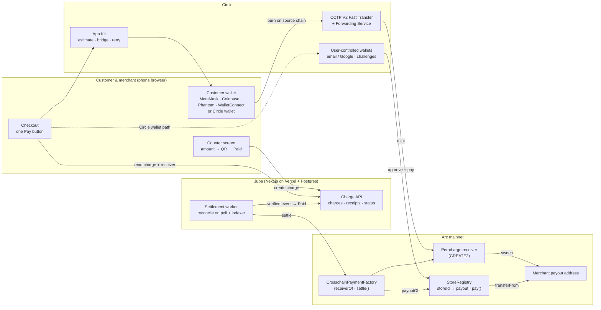
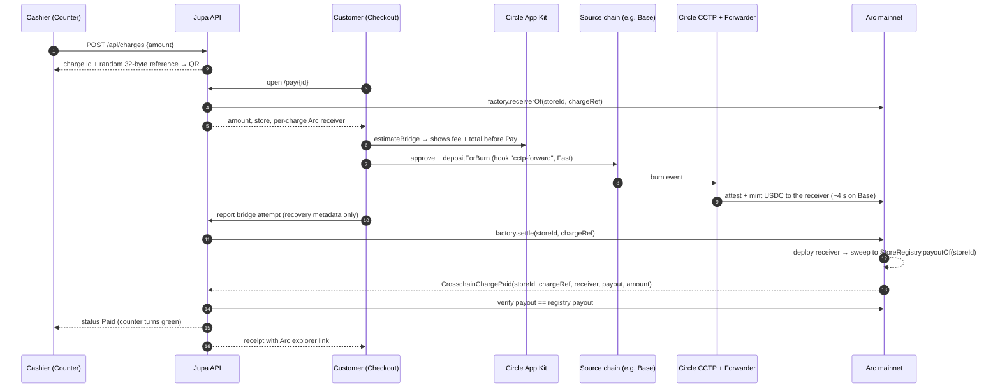
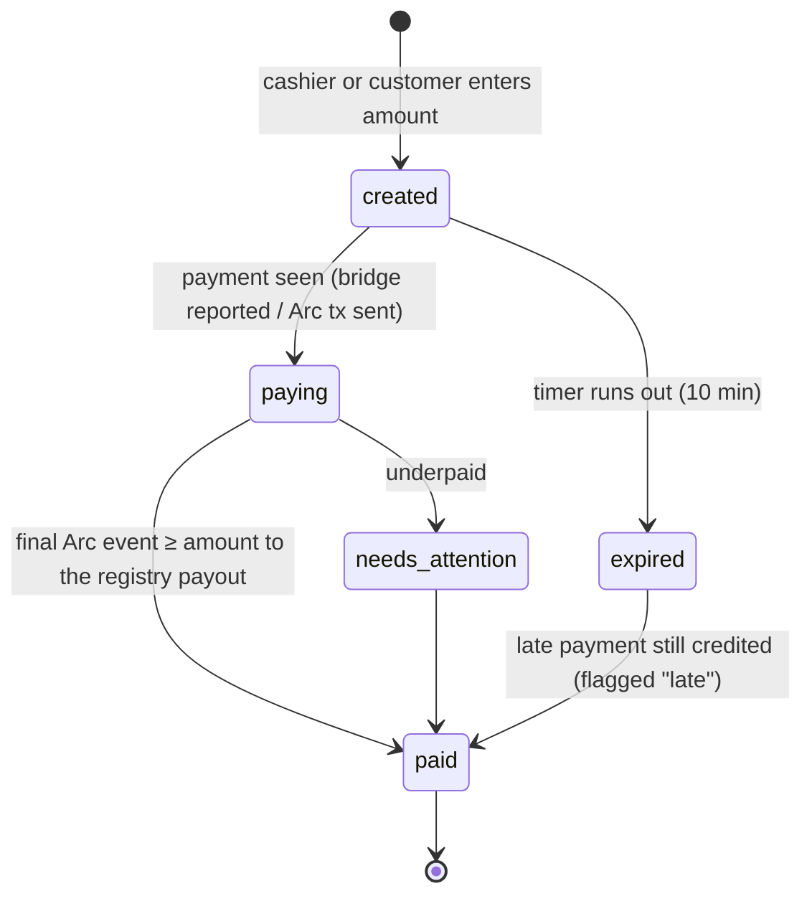

<div align="center">

# Jupa

**Checkout for a real counter.** A customer scans a QR and taps Pay. The merchant receives USDC on **Arc**, no matter which chain the customer's USDC started on.

[Live app](https://jupa-z9gc.vercel.app) · [Contracts on Arc mainnet](#deployed-contracts-arc-mainnet) · [Mainnet payments](#proof-real-payments-on-arc-mainnet) · [Architecture](#architecture) · [Run it locally](#run-it-locally)

</div>

---

## TL;DR

| | |
|---|---|
| **What** | A point-of-sale for in-person USDC payments. The merchant enters an amount, the customer scans and pays from the wallet and chain they already use, and the counter screen turns green when the payment is final on Arc. |
| **Why Arc** | Arc is the merchant's single ledger. USDC is both the money and the gas, finality is deterministic in about a block, and Circle's CCTP lands USDC from other chains into one Arc balance. The merchant watches one balance on one chain and never touches a gas token. |
| **Arc and Circle stack used** | Arc mainnet (settlement, USDC as gas) · **CCTP V2** with **Fast Transfer** · Circle **Forwarding Service** · Circle **App Kit** (bridge, EVM and Solana adapters) · Circle **user-controlled wallets** (email OTP and Google, Arc EOA wallets, contract-execution challenges) · two custom Solidity contracts on Arc. |
| **Status** | Live on **Arc mainnet** (chain 5042). Contracts deployed and verifiable. Four real Base → Arc payments made. CCTP leg measured at **4 seconds**, burn on Base to mint on Arc. |
| **Custody** | **None.** Funds go customer → Circle CCTP → a per-charge contract on Arc → the merchant's payout address, which is read from an onchain registry. Jupa's servers cannot redirect a payment. |

---

## Contents

1. [The problem](#the-problem)
2. [The solution](#the-solution)
3. [Proof: real payments on Arc mainnet](#proof-real-payments-on-arc-mainnet)
4. [How Arc and Circle are used](#how-arc-and-circle-are-used)
5. [Architecture](#architecture)
6. [Smart contracts](#smart-contracts)
7. [Payment lifecycle and matching](#payment-lifecycle-and-matching)
8. [Security model](#security-model)
9. [Product walkthrough](#product-walkthrough)
10. [Design decisions and trade-offs](#design-decisions-and-trade-offs)
11. [Requirements status](#requirements-status)
12. [Run it locally](#run-it-locally)
13. [Testing](#testing)
14. [Repository layout](#repository-layout)
15. [Known limitations and roadmap](#known-limitations-and-roadmap)

---

## The problem

People who hold USDC hold it on many chains: Base, Ethereum, Arbitrum, Solana and more. A merchant who wants to accept it in person has two bad options:

1. **Support every chain.** Watch several balances, hold a gas token on each, and reconcile payments by hand.
2. **Make customers bridge first.** Nobody bridges at a till with a queue behind them.

So in-person stablecoin payments rarely happen, even at crypto events where most attendees hold USDC. The customer has the money and the merchant wants it, but chain fragmentation sits between them.

## The solution

Jupa turns "which chain?" into an implementation detail.

```
Merchant registers once ──► sets an Arc payout address ──► prints a QR
Cashier types an amount ──► customer scans, sees store + price, taps Pay
Jupa routes the USDC from wherever it sits ──► merchant on Arc ──► counter shows Paid
```

- **One action per screen.** The cashier sees one number; the customer sees one button.
- **One ledger.** Every payment, from any source chain, ends as USDC at the merchant's address on Arc.
- **Honest status.** The counter shows *Paid* only after the Arc transfer is final and has been checked against the onchain registry.
- **No app install.** The counter, checkout and receipts all run in a phone browser.

The first market is **vendors at crypto events** (food, merch, tickets), because that is where customers already hold USDC across several chains and buy in person.

---

## Proof: real payments on Arc mainnet

All of these can be checked on-chain. The team re-verified them with the commands in [Verify it yourself](#verify-it-yourself).

### Deployed contracts (Arc mainnet)

| Contract | Address | Deployment tx (block 25,832,244) |
|---|---|---|
| `StoreRegistry` | [`0xc2B0D2A7e858F13B349843fF87dBF4EBF9227F49`](https://explorer.arc.io/address/0xc2B0D2A7e858F13B349843fF87dBF4EBF9227F49) | [`0x7db78a05…f9a560`](https://explorer.arc.io/tx/0x7db78a059cf2d1ebcc3bcf245dbf14a3b2bc4c19f38cb7a0cd4fc2e1b8f9a560) |
| `CrosschainPaymentFactory` | [`0xF7602C048F8C7Cc5E8c514522D633eb9A16a3a1B`](https://explorer.arc.io/address/0xF7602C048F8C7Cc5E8c514522D633eb9A16a3a1B) | [`0x2cd3daf5…5ce0d`](https://explorer.arc.io/tx/0x2cd3daf54fcd38ab5ccfa4e64aee373a8d094401a291605ff056e780ad85ce0d) |

Network facts used by the app, confirmed against the live RPC: Arc mainnet chain ID **5042**, USDC ERC-20 at `0x3600000000000000000000000000000000000000` (6 decimals), CCTP domain **26**, TokenMessengerV2 `0x28b5a0e9C621a5BadaA536219b3a228C8168cf5d`.

### Cross-chain payments (Base → Arc)

Each row is one customer payment. "CCTP" is the time from the burn on Base to the mint on Arc, measured from block timestamps.

| Charge | Amount | Burn on Base | Mint on Arc | Settle on Arc | CCTP | Mint → settled |
|---|---|---|---|---|---|---|
| `YLPMt9Fx…` | 0.021 USDC | [`0x85144d2c…`](https://basescan.org/tx/0x85144d2c21db537b16a214c5f49b9029ecc64e9ffdebd955e0c99aef82a7213a) | [`0x2f9098dc…`](https://explorer.arc.io/tx/0x2f9098dce22b0d268dfe7087616294595ec5f9dc73a6b1ec716953f90ded3f96) | [`0x9d1ba66f…`](https://explorer.arc.io/tx/0x9d1ba66f8cad2934bc35ebbdf52e3bda9159593d7bcbcf99a045d922809aa60d) | **4 s** | **6 s** |
| `7RV7s7XV…` | 0.020 USDC | [`0xcfae6d6e…`](https://basescan.org/tx/0xcfae6d6e8b5731395cf7056a8bff78721706ac6d3fb093e8226d28da2faf11c5) | [`0xf31cc74c…`](https://explorer.arc.io/tx/0xf31cc74c0a8dec426b3923599382f52d00ca47a52742b04097665f51b2801a1d) | [`0xac5ef30a…`](https://explorer.arc.io/tx/0xac5ef30a9756bfb0cbc64b16c77a97fbedb3099a8a45a488a51b02bd15ef368e) | 4 s | 48 min ¹ |
| `Lm3rqMyT…` | 0.020 USDC | [`0x0781a51a…`](https://basescan.org/tx/0x0781a51addab962c125f9c7bef0b535a317a01b4a05208a67d7817ba6fba6cde) | [`0xdac81aa4…`](https://explorer.arc.io/tx/0xdac81aa4a92ca8b783ab16615a08b1c70dcc096efae3d308bb2ad13c10b7ae01) | [`0xb68b344d…`](https://explorer.arc.io/tx/0xb68b344d01225c5eca7430b6a472d7d21975b12c5837da9935229a0d2f886a6e) | 4 s | 18 min ¹ |
| `5mc5qb3E…` | 0.021 USDC | [`0xdf71fb47…`](https://basescan.org/tx/0xdf71fb479e4cb046b69cdcf8d8fbdb7ccc2078ea963d25d5eecc93f6e686bca6) | [`0x9d2a1560…`](https://explorer.arc.io/tx/0x9d2a1560459acb3e0c086c4a4c6678ddcee7e27f61a07041c4a85d6c6c574236) | pending ² | 4 s | — |

What the transactions show:

- **The CCTP leg is fast and exact.** For charge `5mc5qb3E…`, Circle's attestation API reports `minFinalityThreshold: 1000` (Fast Transfer), `feeExecuted: 0` and `forwardState: COMPLETE`. The burn was 21,000 base units and exactly 21,000 were minted on Arc. Fees are paid on the source chain, so the merchant receives the full invoice amount.
- **Each `settle` emits exactly one `CrosschainChargePaid`** from the factory and forwards the receiver's whole balance to the payout address held in `StoreRegistry`.

¹ *The early settlement delays were a bug in our app, not in Arc or CCTP: settlement only ran while a browser was polling, and the server signer was missing in production. Both are fixed: the signer is configured, failures are logged, and the latest payment settled in 6 s. A continuously running indexer (below) removes the dependence on a browser being open.*
² *The USDC is safe in its counterfactual receiver on Arc. It settles on the next `settle(storeId, chargeRef)`, which anyone can call.*

> **Note on the test store.** These payments were made to the team's own test store, whose payout address is our operational wallet `0x2e5d8B56…f6ea`. A real merchant registers their own address, or creates a Circle wallet during onboarding.

### Verify it yourself

```bash
ARC=https://rpc.mainnet.arc.io
FACTORY=0xF7602C048F8C7Cc5E8c514522D633eb9A16a3a1B

# 1. The contracts exist on Arc mainnet
cast chain-id --rpc-url $ARC                                    # 5042
cast code 0xc2B0D2A7e858F13B349843fF87dBF4EBF9227F49 --rpc-url $ARC | wc -c
cast code $FACTORY --rpc-url $ARC | wc -c

# 2. A settlement transaction succeeded and was sent to the factory
cast receipt 0x9d1ba66f8cad2934bc35ebbdf52e3bda9159593d7bcbcf99a045d922809aa60d --rpc-url $ARC status to

# 3. Circle's view of a CCTP transfer (source domain 6 = Base)
curl -s "https://iris-api.circle.com/v2/messages/6?transactionHash=0xdf71fb479e4cb046b69cdcf8d8fbdb7ccc2078ea963d25d5eecc93f6e686bca6" | jq '.messages[0] | {status, forwardState, forwardTxHash}'
```

---

## How Arc and Circle are used

Each item lists the exact place in the code where it happens.

### 1. Arc as the settlement layer

- **Every payment ends as one USDC transfer on Arc** to the merchant's payout address. Merchants never need another asset, because on Arc **USDC is the gas token**.
- **Two views of one balance.** On Arc, USDC has an 18-decimal native view (used for gas and `msg.value`) and a 6-decimal ERC-20 view at `0x3600…0000`. Jupa uses the ERC-20 view for every amount, balance and transfer, and stores amounts as `bigint` base units. It never adds the two views together, which would double-count one pool ([`packages/shared/src/usdc.ts`](packages/shared/src/usdc.ts), [`packages/shared/src/arc.ts`](packages/shared/src/arc.ts)).
- **Deterministic finality.** An included Arc block is final, so the counter turns green on the settlement receipt. There are no confirmation-count heuristics and no reorg handling.
- **Network config, verified against the live chains** for both Arc testnet (5042002) and mainnet (5042): chain, USDC address, CCTP domain 26 and CCTP contracts ([`arc.ts`](packages/shared/src/arc.ts)).

### 2. CCTP V2 with Fast Transfer: moving USDC onto Arc

The checkout uses **Circle App Kit** to burn USDC on the customer's chain and mint it on Arc:

```ts
// apps/web/src/components/checkout/checkout.tsx
await kit.bridge({
  from: { adapter, chain: source.chain },               // e.g. BridgeChain.Base
  to:   { chain: BridgeChain.Arc,
          recipientAddress: charge.crosschainRecipient, // per-charge receiver on Arc (see §4)
          useForwarder: true },                          // Circle Forwarding Service mints on Arc
  amount: "0.021",                                       // exact invoice amount
  config: { feePayment: "source",                        // customer pays fees, merchant gets the full amount
            transferSpeed: source.slow ? "SLOW" : "FAST" },
  quote: quote.raw,                                      // fee shown to the customer before they confirm
});
```

- **`estimateBridge` first.** The customer sees the fee and total debit *before* tapping Pay. Slow paths are never hidden behind a spinner.
- **Fast Transfer** where the source chain supports it. Measured on mainnet: 4 seconds from the Base burn to the Arc mint.
- **Recovery.** If a step fails, the `BridgeResult` is saved in session storage and resumed with `kit.retryBridge`, so a closed tab or a rejected prompt does not strand funds mid-transfer.
- **Source chains.** EVM chains use `@circle-fin/adapter-viem-v2`; Solana uses `@circle-fin/adapter-solana-kit`. The mainnet list is Ethereum, Base, Arbitrum, Avalanche, Optimism, Polygon, Unichain, Linea and Solana. **Base → Arc is proven on mainnet**; the others use the same code path but haven't had a live mainnet payment yet.

### 3. Circle Forwarding Service

With `useForwarder: true`, the burn carries the `cctp-forward` hook. Circle then submits the mint on Arc itself, so the customer never needs USDC on Arc to pay gas, or even an Arc wallet. This is visible on-chain: the burn's `hookData` is `0x636374702d666f7277617264…` ("cctp-forward"), and Circle's API reports `forwardState: COMPLETE` with the Arc mint transaction hash.

### 4. Per-charge receivers on Arc (our contracts)

Two payments of the same amount to the same store must never be confused, and a payment must never depend on Jupa's server to pick the destination. So every charge gets its own **counterfactual CREATE2 address on Arc**:

```
receiver = CREATE2(factory, salt = keccak256(storeId, chargeRef), initCode(usdc, registry, storeId))
```

- CCTP mints straight to that address before any code exists there.
- `CrosschainPaymentFactory.settle(storeId, chargeRef)` deploys the receiver, which sweeps its whole balance to `StoreRegistry.payoutOf(storeId)`, and emits `CrosschainChargePaid(storeId, chargeRef, receiver, payout, amount)`.
- `settle` is **permissionless**. Anyone can call it, and the destination still comes only from the registry. Jupa's relayer, the indexer and a third party all reach the same result.

### 5. Direct payment on Arc

A customer who already holds USDC on Arc pays through `StoreRegistry.pay(storeId, chargeRef, amount)`. It calls `transferFrom` from the customer straight to the payout address and emits `ChargePaid` with the charge reference. The contract never holds funds, and `paidCharges[storeId][chargeRef]` makes every reference single-use.

### 6. Circle user-controlled wallets

- **Merchant sign-in** by email one-time code or Google, through Circle's Web SDK. The server confirms every Circle `userToken` with `getUserStatus` before creating a Jupa session ([`apps/web/src/lib/circle.ts`](apps/web/src/lib/circle.ts)).
- **"Create a wallet" during onboarding** creates an **Arc EOA** for merchants who don't have an Arc address (`createUserPinWithWallets({ blockchains: ["ARC"], accountType: "EOA" })`).
- **The Jupa-wallet checkout path** lets customers without a browser wallet pay from a Circle wallet on Arc. The server prepares, and the user approves in Circle's own window:
  1. `approve(StoreRegistry, amount)` on Arc USDC, via `createUserTransactionContractExecutionChallenge`.
  2. `StoreRegistry.pay(storeId, chargeRef, amount)`, via a second contract-execution challenge.

  Jupa never sees a key. Every transaction is a user-approved Circle challenge ([`apps/web/src/app/api/checkout/[chargeId]/route.ts`](apps/web/src/app/api/checkout/%5BchargeId%5D/route.ts)).

---

## Architecture



**Money never touches Jupa's servers.** The backend creates charges, reads Arc and pays gas for `settle` calls. Every transfer of value is either signed by the customer or follows a destination fixed by `StoreRegistry`.

### Cross-chain payment, step by step



---

## Smart contracts

Solidity `^0.8.24`, Foundry, in [`contracts/src`](contracts/src).

### `StoreRegistry`: where each store gets paid

| Function | Who | Purpose |
|---|---|---|
| `register(storeId, owner, payout)` | approved **registrar** (Jupa's relayer) | Create a store. Rejects a zero ID, zero addresses and duplicates. |
| `setPayout(storeId, payout)` | store **owner** only | Change where money goes. The relayer **cannot** do this. |
| `transferOwnership` / `acceptOwnership` | owner → pending owner | Two-step store ownership transfer. |
| `setRegistrar`, `transferAdmin` / `acceptAdmin` | **admin** | Rotate relayers. Two-step admin handover. |
| `payoutOf(storeId)` | anyone | The source of truth for the checkout and the factory. |
| `pay(storeId, chargeRef, amount)` | customer | Direct Arc payment: `transferFrom` customer → payout. Single-use `chargeRef`, checks-effects-interactions ordering, emits `ChargePaid`. |

### `CrosschainPaymentFactory` + `CrosschainPaymentReceiver`

| Function | Purpose |
|---|---|
| `receiverOf(storeId, chargeRef)` | CREATE2 address that CCTP mints to; deterministic before deployment. |
| `settle(storeId, chargeRef)` | Deploy the receiver if needed, sweep its whole balance to `registry.payoutOf(storeId)`, emit `CrosschainChargePaid`. Permissionless. |
| `CrosschainPaymentReceiver.sweep()` | Factory-only; stays callable after deployment, so a later mint to the same address (dust or a retry) can never be trapped. |

The receiver stores **no destination address**. It looks up the payout in the registry at sweep time, so a merchant who rotates their payout keeps receiving funds that are still in flight.

---

## Payment lifecycle and matching



**Matching rule.** Every charge gets a random 32-byte `reference`. A charge becomes *Paid* only when **all** of these hold:

1. A final Arc event carries the charge's `(storeId, chargeRef)`: `ChargePaid` from the registry or `CrosschainChargePaid` from the factory.
2. The event's payout equals `StoreRegistry.payoutOf(storeId)` at verification time.
3. The amount received is at least the amount charged. An overpayment is credited and flagged; an underpayment goes to `needs_attention`; a payment after expiry is credited and flagged `late`.

These rules live in [`packages/shared/src/charge.ts`](packages/shared/src/charge.ts) (`evaluatePayment`, `canTransition`). Browser reports of a bridge attempt are stored only as **recovery metadata** and never mark a charge Paid on their own.

**Idempotent indexing.** `payment_events` is keyed by `txHash:logIndex`, so replays and races between the request-time reconciler and the indexer can't double-count.

**Indexer** ([`apps/indexer`](apps/indexer/src/index.ts)) watches both `ChargePaid` and `CrosschainChargePaid`, replays from the deployment blocks in bounded windows (Arc's public RPC limits `eth_getLogs` ranges), settles funded receivers, and checks every payout against the registry.

---

## Security model

| Threat | Mitigation |
|---|---|
| A tampered page swaps the destination | The destination is never taken from the browser. Direct pay reads `payoutOf` on-chain; cross-chain funds go to a CREATE2 receiver whose code can only send to `registry.payoutOf(storeId)`. |
| Jupa's server or relayer redirects funds | The relayer can only `register` new stores and call `settle`, which can't choose a destination. Only the store owner can `setPayout`. The admin can only rotate relayers. |
| Same amount, two customers | Every charge has its own random reference and its own receiver address, so the amount is never used for matching. |
| Replay or double payment of one charge | `paidCharges` makes direct-pay references single-use; idempotent `payment_events`; a factory sweep moves the balance once. |
| Stuck cross-chain funds | `settle` is permissionless; `sweep()` stays callable after deployment; App Kit `retryBridge` resumes from the last completed step. |
| Malicious token re-entrancy | `pay()` writes `paidCharges` before the external `transferFrom` (checks-effects-interactions). |
| Key exposure | No private keys stored for users (Circle MPC wallets, user-approved challenges). Deploys use an encrypted Foundry keystore (`--account`); `DeployMainnet` refuses to run off chain 5042 or with `admin == relayer`. |
| Sessions | Opaque random tokens; only the SHA-256 is stored; httpOnly, SameSite=Lax cookies; Circle tokens verified server-side. |
| Privacy | No customer names or emails stored. Receipts hold only amount, time, source chain and transaction hashes. |

---

## Product walkthrough

| Screen | Who | What happens |
|---|---|---|
| **Onboarding** `/onboard` | Merchant | Email code or Google → store name, optional logo, payout address (or *Create a wallet*) → the store is registered on Arc → printable QR, payment link and counter link. Target: under 2 minutes. |
| **Counter** `/till/{store}` | Cashier | Number pad → *Charge* → a large QR with a countdown → live status → full-screen green **Paid**. Expired QRs can be regenerated. |
| **Payment page** `/s/{store}` | Customer | The printed QR on the counter. Customers can enter an amount themselves, so the store takes payments even when nobody is at the counter. |
| **Checkout** `/pay/{charge}` | Customer | Store and price, then one button. On a phone it offers *Open in MetaMask / Coinbase Wallet / Trust Wallet / Phantom*, so approvals happen inside the wallet's browser; WalletConnect is the fallback. |
| **Receipt** `/receipt/{charge}` | Both | Amount, store, time, source chain and Arc explorer link. Also how a customer recovers a payment if they closed the page. |
| **Dashboard** `/dashboard` | Merchant | Collected today, payment count, in-progress count, average, and recent activity (received / processing / failed / waiting at the counter). |

---

## Design decisions and trade-offs

**Counterfactual receivers instead of amount tags or memos.** Amount tags (paying $4.500017 to mark a charge) break when fees or rounding change the amount, and CCTP mints carry no memo. A per-charge CREATE2 address encodes the charge in the destination itself, keeps the merchant's address clean, and needs no extra transaction from the customer.

**Forwarding Service over a self-run attestation relayer.** Circle submits the Arc mint, so the customer needs no Arc gas and Jupa runs no attestation infrastructure for the cross-chain leg.

**Fees on the source chain.** `feePayment: "source"` keeps the merchant's received amount equal to the invoice. On mainnet, `feeExecuted` was 0 and the mint matched the burn to the base unit.

**Permissionless settlement.** Settlement doesn't depend on Jupa's uptime or honesty. The relayer is a convenience, not a trusted party.

**Registry as the source of truth.** The database caches the payout address for display, but money only ever follows `StoreRegistry`.

**Open in the wallet's browser on phones.** WalletConnect from a mobile browser does not bring the wallet app forward for each request. Reopening the checkout inside the wallet's own browser makes every approval appear right there, which is what a counter with a queue needs.

---

## Requirements status

From the product requirements: P0 is the v1 core, P1 is next, P2 is roadmap.

| ID | Requirement | Pri. | Status |
|---|---|---|---|
| F1 | Merchant sign-in (email), store profile, Arc payout address | P0 | ✅ Email OTP + Google via Circle; optional Circle-created Arc wallet |
| F2 | Store registry contract on Arc | P0 | ✅ Live on mainnet |
| F3 | Counter: amount, per-charge QR, countdown, live status, Paid | P0 | ✅ |
| F4 | Checkout: store, price, wallet connect, single Pay | P0 | ✅ Desktop wallets, mobile in-wallet browsers, WalletConnect |
| F5 | Direct pay from USDC on Arc | P0 | ✅ `StoreRegistry.pay` via Circle wallet (approve + pay challenges) |
| F6 | Cross-chain pay from Base via App Kit / CCTP | P0 | ✅ Four mainnet payments, 4 s CCTP |
| F7 | Paid only on a final, matching Arc transfer | P0 | ✅ Event + registry-payout check + amount rules |
| F8 | Receipt with amount, time, store, source, explorer link | P0 | ✅ |
| F9 | Merchant dashboard: today's payments | P0 | ✅ (Arc balance view: roadmap) |
| F10 | Cross-chain from Ethereum, Arbitrum, Solana | P1 | 🟡 Wired through App Kit; not yet proven on mainnet |
| F11 | Gateway unified balance path | P1 | ⏳ Roadmap |
| F12 | Payment links with embedded or self-entered amounts | P1 | ✅ Public payment page `/s/{store}` |
| F13 | Sponsored gas for merchant actions | P1 | 🟡 Jupa's relayer pays registration and settlement gas; Gas Station: roadmap |
| F14 | CSV export | P1 | ⏳ Roadmap |
| F15–16 | Refunds, tips, staff roles, off-ramp | P2 | ⏳ Roadmap |

---

## Run it locally

**Requirements:** Node 24, pnpm 10, Foundry, Postgres (local, Docker or Supabase).

```bash
git clone https://github.com/JamesVictor-O/Jupa && cd Jupa
pnpm install
git submodule update --init            # forge-std
cp .env.example .env                   # fill in the values below
pnpm db:up && pnpm db:push             # Postgres in Docker + schema
pnpm dev:all                           # web (http://localhost:3000) + indexer
```

| Variable | Purpose |
|---|---|
| `ARC_NETWORK`, `NEXT_PUBLIC_ARC_NETWORK` | `testnet` or `mainnet` (keep in sync) |
| `ARC_MAINNET_RPC_URL`, `ARC_TESTNET_RPC_URL` | Public Arc RPCs (`https://rpc.mainnet.arc.io`, `https://rpc.testnet.arc.io`) |
| `ARC_RPC_URL` | Optional dedicated RPC for the app and indexer |
| `STORE_REGISTRY_ADDRESS`, `CROSSCHAIN_PAYMENT_FACTORY_ADDRESS` (+ `NEXT_PUBLIC_` copies) | Deployed contracts |
| `STORE_REGISTRY_DEPLOYMENT_BLOCK`, `CROSSCHAIN_FACTORY_DEPLOYMENT_BLOCK` | Where the indexer starts replaying |
| `REGISTRY_ADMIN`, `REGISTRY_RELAYER` | Governance and operational addresses (must differ) |
| `RELAYER_PRIVATE_KEY` | Server signer that pays USDC gas for `register` and `settle` (use a managed signer in production) |
| `DATABASE_URL`, `DIRECT_URL` | Postgres (Supabase transaction pooler on Vercel; direct URL for schema tooling) |
| `CIRCLE_API_KEY`, `CIRCLE_APP_ID` | Circle user-controlled wallets (server key; app ID from the Configurator) |
| `NEXT_PUBLIC_GOOGLE_CLIENT_ID` | Google sign-in through Circle social login |
| `NEXT_PUBLIC_WALLETCONNECT_PROJECT_ID` | WalletConnect fallback on mobile |

**Deploy the contracts** (encrypted keystore, never a raw key):

```bash
cd contracts
cast wallet import jupa-deployer --interactive
REGISTRY_ADMIN=0x... REGISTRY_RELAYER=0x... \
  forge script script/DeployMainnet.s.sol:DeployMainnet \
  --rpc-url arc_mainnet --account jupa-deployer --broadcast
```

For testnet, use `script/Deploy.s.sol` and `script/DeployCrosschain.s.sol` with `--rpc-url arc_testnet`.

---

## Testing

```bash
pnpm test               # TypeScript (vitest) + contracts (forge)
cd contracts && forge test -vv
```

- **23 Foundry tests** across `StoreRegistry` and `CrosschainPaymentFactory`:
  - Access control: registrar-only `register`, owner-only `setPayout`, two-step admin and ownership transfers.
  - Input validation and duplicate-store rejection.
  - A **fuzz test** showing `pay()` always lands the full amount at the payout and leaves the contract with zero balance.
  - Single-use charge references, and a failed transfer not consuming a charge.
  - Cross-chain: the counterfactual receiver forwards its entire balance; settlement uses the *latest* registry payout; no settlement before funds arrive; later mints to a deployed receiver can still be swept; only the factory can sweep; a failed transfer doesn't deploy the receiver.
- **8 vitest tests:**
  - Exact 6-decimal USDC parsing (reject, never round).
  - Display formatting that never truncates sub-cent amounts.
  - Charge rules (late, overpaid and underpaid).
  - Arc network config.

---

## Repository layout

```
apps/web          Next.js 16 app: landing, onboarding, counter, checkout, receipts, dashboard, API
  src/app/api       charges · checkout (Circle wallet path, bridge attempts) · auth · stores · wallet
  src/lib           circle.ts · registry.ts · crosschain.ts · reconcile-charge.ts · mobile-wallets.ts
apps/indexer      Arc watcher: ChargePaid + CrosschainChargePaid, replay, settle, verify payout
packages/shared   Arc network config, USDC amount maths, charge rules, contract ABIs
packages/db       Drizzle schema: merchants, sessions, stores, charges, payments, payment_events, bridge_attempts
contracts         Foundry: StoreRegistry, CrosschainPaymentFactory (+ tests, deploy scripts)
```

---

## Known limitations and roadmap

Known limitations, stated plainly:

- **The indexer must run continuously in production.** Today settlement also runs while a counter or checkout page is polling; a hosted indexer makes it independent of any open browser.
- **Only Base → Arc is proven on mainnet.** The other source chains share the code path and need a live payment each.
- **Customer-facing copy** on the cross-chain checkout still names the network and fee type. The goal is "Pay / Paying / Paid" with a single line naming the balance used.
- **The relayer key is an environment variable** on the web host; a managed signer (KMS or Circle developer-controlled wallets) is planned.

Roadmap:

1. **Circle Gateway:** spend a unified USDC balance to Arc in one approval for near-instant cross-chain pay.
2. **Off-ramp:** merchant withdraws to local currency through a partner.
3. **Card and Apple Pay checkout** via Circle's Onramp Kit.
4. **Gas Station / Paymaster** for fully sponsored merchant actions.
5. **Refunds, tips, staff accounts, several counters per store, CSV export.**
6. **Plugins** for event ticketing and online stores.

---

<div align="center">

Built for the **Arc Microgrants** program · settlement on **Arc** · cross-chain by **Circle CCTP**

</div>
